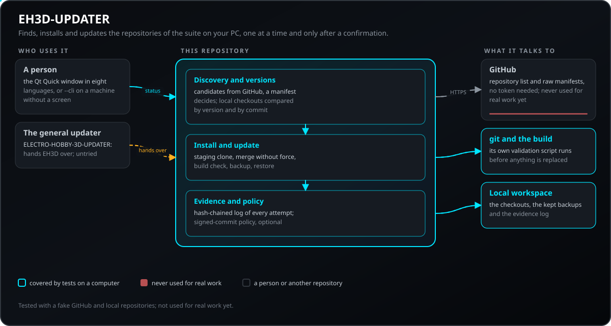
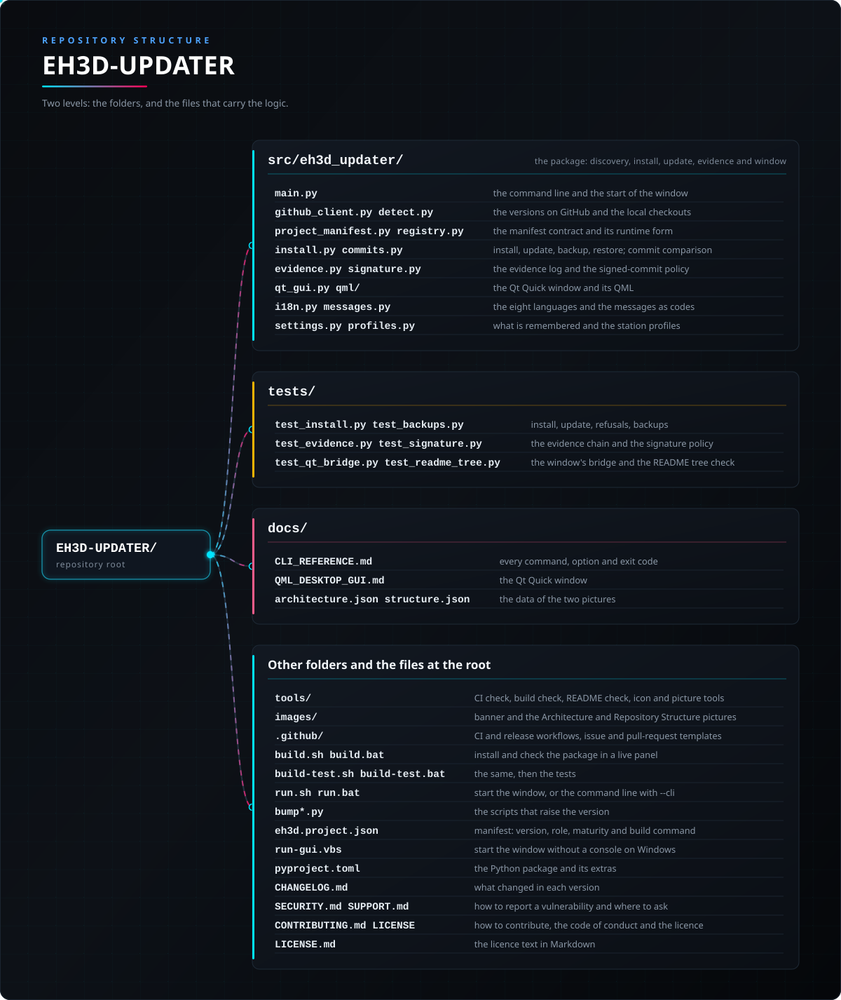

<p align="center">
  
</p>

# 🛠️ EH3D-UPDATER

<p align="center"><a href="README.md">🇺🇸 English</a> | <a href="README_spa.md">🇪🇸 Español</a> | <a href="README_fra.md">🇫🇷 Français</a> | <a href="README_ita.md">🇮🇹 Italiano</a> | 🇩🇪 <b>Deutsch</b> | <a href="README_zho.md">🇨🇳 中文</a> | <a href="README_jpn.md">🇯🇵 日本語</a> | <a href="README_por.md">🇵🇹 Português</a></p>

### Erkennt, installiert und aktualisiert die Repositories der EH3D Fabrication Suite auf deinem PC: Nichts geschieht von selbst, und eine laufende Installation wird erst ersetzt, nachdem ihr Ersatz gebaut und geprüft wurde

<p align="center">
  
  
  
  
  
</p>

---

**Ehrlichkeitscheck - was heute tatsächlich läuft:** eine Kommandozeile und ein Qt-Quick-Fenster, die die EH3D-Repositories über ihre `eh3d.project.json`-Manifeste finden, jeden lokalen Checkout mit GitHub vergleichen und nach einer Bestätigung eines nach dem anderen installieren oder aktualisieren. Das Update wird geklont, ohne Zwang zusammengeführt und zuerst in einem Staging-Klon gebaut und geprüft, und die vorherige Installation bleibt als Sicherung erhalten. Es ist der Updater der anderen Ökosysteme der Familie mit den Namen von EH3D, mit 322 Tests, die auf einem Computer mit einem falschen GitHub und lokalen Repositories laufen. Es wurde noch nicht für echte Arbeit verwendet und hat nie ein Projekt vom echten GitHub installiert oder aktualisiert.

---

> **Stand von Sicherheit und IT-Sicherheit:** es ersetzt Dateien auf deinem Rechner und führt die Build-Prüfung dessen aus, was es installiert; deshalb tut es das nur nach ausdrücklicher Bestätigung, nie über einem Checkout mit lokalen Änderungen, und es hält jeden Versuch in einem Nachweisprotokoll ohne Geheimnisse fest. Es prüft die Signatur eines Commits nur, wenn du diese Richtlinie wählst; es ist kein Sicherheitssystem (Safety) und steuert keine Maschine.

## 📋 Auf einen Blick

| | |
|---|---|
| Version | `0.0.2` |
| Reifegrad | Gerüst |
| Tests | 322 |
| Technologie-Stack | Python 3.10+ / PySide6 / Qt Quick |
| Auf echter Hardware | Nicht zutreffend: Es läuft auf dem PC der Person, die es nutzt |

**Springe zu:** [Überblick](#-überblick) · [Architektur](#-architektur) · [Schnellstart](#-schnellstart) · [Tests](#-tests) · [Struktur](#-struktur-des-repositorys) · [Verwandte](#-verwandte-projekte)

## 🚦 Projektstatus

Jede Zeile ist ein Teil dieses Repositorys, und die Ampel sagt, wie weit er heute ist. Sie beruht auf dem, was das Repository zeigen kann (Tests, Builds, Läufe), nicht auf dem, was geplant ist.

🟢 Fertig und überprüft · 🟡 Funktioniert, mit bekannten Grenzen · 🟠 Teilweise fertig oder noch nicht überprüft · 🔴 Nicht gemacht oder funktioniert nicht

| Bereich | Stand | Was das hier bedeutet |
|---|---|---|
| Software | 🟡 | Eine Kommandozeile und ein Qt-Quick-Fenster finden die EH3D-Repositories über ihre Manifeste, vergleichen sie mit GitHub und installieren oder aktualisieren eines nach dem anderen, mit einem Staging-Klon und einer Sicherung der vorherigen Installation. |
| Tests | 🟢 | 322 Tests bestehen (`pytest`), mit einem falschen GitHub und lokalen Repositories (ohne Netz); ein weiterer wird übersprungen, wenn ein dafür nötiger Nachbar-Checkout fehlt. |
| Erkennung | 🟡 | Öffentliche Repositories sind nur Kandidaten: Ein Projekt gehört zum Ökosystem, wenn sein `eh3d.project.json` im Wurzelverzeichnis gültig ist und `EH3D` sagt; gegen eine falsche Liste getestet, nicht gegen das echte GitHub. |
| Echter Einsatz | 🟠 | Es wurde noch nicht für echte Arbeit verwendet und hat nie ein Projekt vom echten GitHub installiert oder aktualisiert; es gibt nur wenige EH3D-Repositories zum Installieren. |
| Oberfläche | 🟡 | Das Fenster arbeitet in acht Sprachen, und seine Python-Brücke ist von Tests abgedeckt; die Kommandozeile braucht nur die Standardbibliothek. |
| Sicherheit | 🟡 | Nichts ändert sich ohne Bestätigung oder über einem Checkout mit lokalen Änderungen, Zusammenführungen erzwingen nie, und ein Nachweisprotokoll zeigt bearbeitete oder umgeordnete Zeilen; die Richtlinie für signierte Commits ist optional, und es gab keine unabhängige Prüfung. |
| Integration | 🟡 | ELECTRO-HOBBY-3D-UPDATER übergibt ihm die EH3D-Projekte; diese Übergabe wurde nicht an einem echten Checkout ausgeführt. |
| Echte Hardware | 🟢 | Nicht zutreffend: Es läuft auf dem PC der Person, die es nutzt. |
| Dokumentation | 🟢 | README in acht Sprachen, die Kommandozeilenreferenz und die Anleitung zum Fenster. |

## 🎯 Überblick

* **Es findet die Projekte über ihre Manifeste:** Die öffentlichen Repositories des Besitzers auf GitHub sind nur eine Liste von Kandidaten; eines ist ein Projekt, wenn sein `eh3d.project.json` im Wurzelverzeichnis gültig ist und das Ökosystem `EH3D` angibt. Ein neues Repository erscheint also dadurch, dass es ein Manifest hat, und nichts in diesem Werkzeug listet die Projekte auf. Lokal genügt ein Ordnername nie, um zum Ökosystem zu gehören.
* **Es vergleicht den Rechner mit GitHub:** Für jedes Projekt liest es die Version des lokalen Checkouts und die auf dem Standard-Branch von GitHub und sagt, ob es installiert, aktuell, veraltet ist oder neue Commits hat (eine gleiche Version mit neuen Commits fällt mit einem `git ls-remote` auf).
* **Es installiert und aktualisiert ein Projekt nach dem anderen, nach einer Bestätigung:** Der Ersatz wird in einem Staging-Klon gebaut und geprüft, bevor die laufende Installation angefasst wird, und die vorherige bleibt als Sicherung erhalten, die sich im Fenster oder mit `restore-backup` zurückspielen lässt.
* **Auch Stapel werden bestätigt:** *Alle fehlenden installieren* und *Alle veralteten aktualisieren* sind getrennte, aufeinanderfolgende Aktionen über denselben Sicherheitsweg. Nichts aktualisiert sich im Hintergrund.
* **Ein Nachweisprotokoll und eine optionale Richtlinie für signierte Commits:** Jeder Versuch wird in ein Protokoll geschrieben, das später auf bearbeitete, entfernte oder umgeordnete Zeilen geprüft werden kann.
* **Stationsprofile:** Ein benanntes Profil listet die Projekte auf, mit denen ein Rechner arbeitet, und das Fenster und die Befehle folgen ihm.
* **Ein Fenster in acht Sprachen und eine Kommandozeile** (`--cli`), die nur die Standardbibliothek braucht und daher auch auf einem Rechner ohne Bildschirm läuft.

## 🧩 Rolle in EH3D

EH3D-UPDATER ist der Weg, die Suite zu bekommen und aktuell zu halten. ELECTRO-HOBBY-3D-UPDATER, das Werkzeug über den vier Ökosystemen, übergibt ihm die EH3D-Projekte. Ein neues EH3D-Repository braucht hier nichts: Es erscheint, sobald es öffentlich ist und ein gültiges Manifest trägt.

## 🏛️ Architektur

<p align="center">
  
</p>

Wie die Teile dieses Repositorys zusammenpassen: wer es nutzt, was es enthält und wovon es abhängt. Das Bild wird aus `docs/architecture.json` gezeichnet und gegen den Code geprüft.

## ✨ Funktionen

* **Das Manifest entscheidet:** Erkennung, Name, Version, Build-Befehl und Notizen stammen aus dem eigenen `eh3d.project.json` des Repositorys; ein Kandidat mit ungültigem Manifest oder niedrigerer Version als die installierte wird abgewiesen, bevor etwas angefasst wird.
* **Ein gesunder Checkout wird nie ersetzt:** Eine echte lokale Änderung oder ein abgewichener Branch lässt das Update laut scheitern, nie ein stilles Zurücksetzen (`--ff-only` mit `--no-build`).
* **Vorschau vor dem Update:** `update --preview` zeigt den Kandidaten-Commit, seinen Autor, seinen Signaturzustand und die Build- und Werkzeugdateien, die er ändert, und hört dann auf.
* **Nur benachrichtigen:** `check` listet auf, was aktualisiert werden könnte, ändert nichts und endet mit 10, wenn etwas möglich ist (eine Desktop-Benachrichtigung ist optional).
* **Sicherungen mit Grenze:** Die vorherige Installation bleibt als `<Name>.backup-<8 Hex-Ziffern>` erhalten; standardmäßig bleiben die neuesten 2, und `clean-backups` räumt den Rest auf.
* **Rücksichtsvoll zum Netz:** Anfragen werden mit Wartezeit wiederholt, ein kurzes `Retry-After` wird abgewartet, die Repository-Liste wird mit `If-None-Match` zwischengespeichert (ein `304` kostet kein Kontingent), und ein nicht erreichbares GitHub fällt mit einer Warnung auf den lokalen Stand zurück.

## 🔒 Sicherheit und Schutz

| Bedrohung | Abwehr |
|---|---|
| Ein unerwünschtes oder überraschendes Update | Nichts läuft im Hintergrund: `install` und `update` nehmen einen Projektnamen und eine Bestätigung, und die Stapel-Schaltflächen des Fensters sind getrennt, aufeinanderfolgend und bestätigt |
| Ein kaputter Kandidat ersetzt eine funktionierende Installation | Der Kandidat wird in einem Staging-Klon geklont, ohne Zwang zusammengeführt, gebaut und geprüft; der laufende Ordner wird erst danach mit zwei Umbenennungen getauscht, und der vorherige bleibt als wiederherstellbare Sicherung erhalten |
| Lokale Arbeit verlieren | Ein Checkout mit lokalen Änderungen oder ein abgewichener Branch wird nie ersetzt: Das Update scheitert laut |
| Ein Repository, das vorgibt, zur Suite zu gehören | Ein Repository gehört nur dazu, wenn sein Manifest im Wurzelverzeichnis gültig ist und `EH3D` angibt; ein Kandidat mit niedrigerer Version als die installierte wird abgewiesen |
| Ein Commit unbekannter Herkunft | optionale Richtlinie: Mit `EH3D_UPDATER_REQUIRE_SIGNED=1` (oder der Einstellung) und einer Datei erlaubter Unterzeichner muss ein Commit signiert sein; standardmäßig wird ein unsignierter mit Warnung installiert, und `update --preview` zeigt vorher den Signaturzustand |
| Manipulation des Protokolls dessen, was geschah | Jeder Installations- oder Update-Versuch ist eine Zeile eines Nachweisprotokolls, die den Hash der vorherigen Zeile trägt; `evidence` prüft die Kette und endet mit 1, wenn eine Zeile bearbeitet, entfernt oder umgeordnet wurde |
| Geheimnisse preisgeben | Das Nachweisprotokoll trägt keine Geheimnisse; GitHub wird ohne Token gelesen (ein optionales `GITHUB_TOKEN` hebt nur das Anfragelimit); das Werkzeug gibt es nie aus |
| Ein Prüfskript, das hier nicht laufen kann | Eine Installation, die nicht geprüft werden kann, weil ein Werkzeug fehlt, wird abgewiesen, außer du akzeptierst sie (die Einstellung `validation_unavailable` oder `EH3D_UPDATER_ACCEPT_UNAVAILABLE_VALIDATION=1`) |
| Zwei Instanzen gleichzeitig | Eine Instanz, die eine andere im Arbeitsbereich findet, weigert sich, Sicherungen zu bereinigen oder wiederherzustellen |

**Was nicht abgewehrt wird:** Das Build-Skript eines installierten Projekts ist der Code dieses Projekts und läuft mit deinen Rechten, installiere also nur, was du kennst; unsignierte Commits werden standardmäßig akzeptiert; und das Werkzeug wurde nicht unabhängig geprüft. Melde eine Schwachstelle privat (siehe [SECURITY.md](SECURITY.md)).

## 🔌 Schnittstellen

| Schnittstelle | Was es ist | Wo |
|---|---|---|
| Fenster | ein Qt-Quick-Fenster in acht Sprachen (der Standard; braucht das optionale Extra `PySide6`) | `qt_gui.py`, `qml/Main.qml`, [docs/QML_DESKTOP_GUI.md](docs/QML_DESKTOP_GUI.md) |
| Kommandozeile | `eh3d-updater --cli` mit `status`, `install`, `update`, `check`, `clean-backups`, `restore-backup` und `evidence`; Exit-Codes 0, 1 und 10 (etwas kann aktualisiert werden) | [docs/CLI_REFERENCE.md](docs/CLI_REFERENCE.md) |
| GitHub | `GET /users/<Besitzer>/repos` (mit `If-None-Match` zwischengespeichert) und das Roh-Manifest jedes Kandidaten; kein Token nötig | `github_client.py` |
| Der Arbeitsbereich | die Ordner neben dem Werkzeug, `<Name>.backup-xxxxxxxx` für die vorherigen Installationen und `.eh3d-updater/evidence.jsonl` für das Nachweisprotokoll | `install.py`, `evidence.py` |
| Einstellungen | `~/.eh3d_updater_settings.json` (Sprache, Arbeitsbereich, Profil, behaltene Sicherungen, Signaturrichtlinie) | `settings.py` |

## ⚙️ Konfiguration

Zum Start muss nichts konfiguriert werden. Die gemerkten Entscheidungen liegen in `~/.eh3d_updater_settings.json`, und einige lassen sich auch als Optionen oder Umgebungsvariablen angeben.

| Einstellung | Standard | Bereich | Was sie bewirkt |
|---|---|---|---|
| `workspace_root` / `--workspace` | der übergeordnete Ordner des Werkzeugs | ein Ordner | wo Checkouts, Sicherungen und das Nachweisprotokoll liegen |
| `lang` | die Systemsprache | en, es, de, fr, it, ja, zh, pt | die Sprache des Fensters |
| `profile` / `--profile` | keines (alle Projekte) | ein definierter Profilname; ein nicht definierter ist ein Fehler | beschränkt `status`, `check`, `install` und `update` auf die Projekte eines Stationsprofils |
| `backups_to_keep` / `clean-backups --keep` | 2 | eine ganze Zahl ab 0 | wie viele vorherige Installationen je Projekt bleiben |
| `require_signed_commits`, `allowed_signers_file` / `EH3D_UPDATER_REQUIRE_SIGNED=1`, `EH3D_UPDATER_ALLOWED_SIGNERS` | aus | an oder aus | Commits abweisen, die kein erlaubter Unterzeichner signiert hat |
| `validation_unavailable` / `EH3D_UPDATER_ACCEPT_UNAVAILABLE_VALIDATION=1` | abweisen | abweisen oder akzeptieren | was zu tun ist, wenn die Prüfung eines Projekts wegen eines fehlenden Werkzeugs nicht laufen kann |
| `GITHUB_TOKEN` | keines | ein GitHub-Token | hebt nur das Anfragelimit der Liste an; nie erforderlich |
| `--no-build` (install, update) | aus | an oder aus | nur klonen oder holen, ohne die Build-Prüfung des Projekts (ein einfacher Fast-Forward) |

Die Netzwerkwerte sind Konstanten: 10 s je Anfrage, bis zu 8 Anfragen gleichzeitig, 3 Versuche mit Wartezeit und ein `Retry-After` von höchstens 60 s.

## 🚀 Schnellstart

Du brauchst Python 3.10 oder neuer; das Fenster braucht zusätzlich PySide6 (`pip install ".[gui]"`).

```bash
./run.sh --cli status          # run.bat --cli status on Windows
./run.sh --cli status --offline --json
./run.sh --cli check           # exit code 10 when something can be updated
./run.sh --cli update EH3D-COMMON --preview
./run.sh --cli install EH3D-CORE-LIBS
```

`run.sh` / `run.bat` ohne `--cli` öffnen das Fenster. `install` und `update` fragen vor jeder Änderung nach einer Bestätigung und nehmen immer einen Projektnamen.

## 🧪 Tests

Die Suite hat 322 Tests, die bestehen (`pytest tests`), und einen weiteren, der übersprungen wird, wenn ein dafür nötiger Nachbar-Checkout nicht neben diesem liegt. Sie laufen mit einem falschen GitHub und lokalen Repositories ohne Netz und decken den Manifestvertrag, die Erkennung, den Versions- und Commit-Vergleich, Installation und Update mit dem Staging-Klon und die Abweisungen (lokale Änderungen, abgewichener Branch, niedrigere Version, ungültiges Manifest, fehlschlagender Build), Sicherungen und Wiederherstellung, die Nachweiskette, die Signaturrichtlinie, Einstellungen und Profile, die Meldungen und die acht Sprachen des Fensters sowie die Python-Brücke des Fensters (offscreen) ab. Ein Test prüft außerdem, dass der Dateibaum jedes READMEs jeden versionierten Eintrag der ersten Ebene auflistet. Die CI führt sie unter Linux und Windows aus, dazu `python tools/ci_validate.py` und eine Syntaxprüfung jeder Python-Datei.

## 🏗️ Build und Veröffentlichung

Die Version steht in `pyproject.toml`, in `eh3d.project.json` und im Paket, und jede Version hat ihren Eintrag in [CHANGELOG.md](CHANGELOG.md). `build.sh` / `build.bat` installieren das Paket und prüfen es, `build-test.sh` / `build-test.bat` führen zusätzlich die Tests aus, und `test.sh` / `test.bat` führen nur die Tests aus, jeweils in einem Live-Panel; die Version ändert sich nicht. Releases werden auf GitHub veröffentlicht; das Werkzeug wird mit pip aus diesem Repository installiert und liegt nicht auf PyPI.

## 📂 Struktur des Repositorys

<p align="center">
  
</p>

<details>
<summary>Textversion des Baums</summary>

```text
EH3D-UPDATER/
├── src/eh3d_updater/
│   ├── main.py                                  die Kommandozeile und der Start des Fensters
│   ├── github_client.py detect.py               die Versionen auf GitHub und die lokalen Checkouts
│   ├── project_manifest.py registry.py          der Manifestvertrag und seine Laufzeitform
│   ├── install.py commits.py                    Installieren, Update, Sicherung; Commit-Vergleich
│   ├── evidence.py signature.py                 das Nachweisprotokoll und die Signaturrichtlinie
│   ├── qt_gui.py qml/                           das Qt-Quick-Fenster und sein QML
│   ├── i18n.py messages.py                      die acht Sprachen und die Meldungen als Codes
│   └── settings.py profiles.py                  was gemerkt wird und die Stationsprofile
├── tests/                                       ohne Netz: ein falsches GitHub und lokale Repositories
├── docs/                                        die Kommandozeilenreferenz, die Anleitung zum Fenster und die Daten der beiden Bilder
├── tools/                                       CI-, Build-, README-Prüfung, Icon und Bilder
├── images/                                      Banner und die Bilder von Architektur und Repository-Struktur
├── .github/                                     CI- und Release-Workflows, Vorlagen für Issues und Pull Requests
├── build.sh build.bat                           installiert und prüft das Paket in einem Live-Panel
├── build-test.sh build-test.bat                 dasselbe, danach die Tests
├── run.sh run.bat                               startet das Fenster oder mit --cli die Kommandozeile
├── bump*.py                                     die Skripte, die die Version erhöhen
├── eh3d.project.json                            Manifest: Version, Rolle, Reifegrad und Build-Befehl
├── run-gui.vbs                                  startet das Fenster unter Windows ohne Konsole
├── pyproject.toml                               das Python-Paket und seine Extras
├── CHANGELOG.md                                 was sich in jeder Version geändert hat
├── SECURITY.md SUPPORT.md                       Schwachstellen melden und Fragen stellen
├── CONTRIBUTING.md CODE_OF_CONDUCT.md LICENSE   Mitwirken, Verhaltenskodex und Lizenz
└── LICENSE.md                                   der Lizenztext in Markdown
```

</details>

## 🗺️ Roadmap und bekannte Grenzen

**Bekannte Grenzen heute**

* Es hat nie ein Projekt vom echten GitHub installiert oder aktualisiert: Alles ist mit einem falschen GitHub und lokalen Repositories getestet, und es gibt nur wenige EH3D-Repositories zum Installieren.
* Die Übergabe von ELECTRO-HOBBY-3D-UPDATER wurde nicht an einem echten Checkout ausgeführt.
* Commits müssen standardmäßig nicht signiert sein; die Richtlinie ist optional.
* Das Build-Skript eines installierten Projekts läuft mit deinen Rechten.
* Das Werkzeug wurde nicht unabhängig geprüft und liegt nicht auf PyPI.

**Als Nächstes**

* Ein echtes Projekt mit dem echten GitHub von Anfang bis Ende installieren und aktualisieren und festhalten, was sich zeigt.
* Die Übergabe von ELECTRO-HOBBY-3D-UPDATER an einem echten Checkout ausführen.
* Entscheiden, ob signierte Commits für die Suite zum Standard werden.

## 🌍 Sprachen

README und Texte gibt es auf Englisch, Spanisch, Französisch, Italienisch, Deutsch, Chinesisch, Japanisch und europäischem Portugiesisch.

## 🔗 Verwandte Projekte

* [EH3D-COMMON](https://github.com/JuanenRac/EH3D-COMMON): der Projektcontainer und die Maschinentypen; lässt sich mit diesem Werkzeug installieren
* [EH3D-CORE-LIBS](https://github.com/JuanenRac/EH3D-CORE-LIBS): die Leser für Gerber, Excellon und G-Code; lässt sich mit diesem Werkzeug installieren
* [ELECTRO-HOBBY-3D-UPDATER](https://github.com/JuanenRac/ELECTRO-HOBBY-3D-UPDATER): der Updater über den vier Ökosystemen, der an dieses weiterreicht
* [URTC-UPDATER](https://github.com/JuanenRac/URTC-UPDATER): der Updater von URTC, von dem dieses Werkzeug seinen Entwurf übernimmt

## 📚 Dokumentation

* [Kommandozeilenreferenz](docs/CLI_REFERENCE.md): jeder Befehl, jede Option und jeder Exit-Code.
* [Das Desktop-Fenster](docs/QML_DESKTOP_GUI.md): wie das Qt-Quick-Fenster auf denselben Diensten wie die Kommandozeile sitzt.
* [Änderungsprotokoll](CHANGELOG.md)

## 🤝 Mitwirken und Community

* Führe vor einem Pull Request `PYTHONPATH=src python -m pytest tests -q` und `python -I tools/ci_validate.py` aus: alles muss bestehen. Siehe [CONTRIBUTING.md](CONTRIBUTING.md) und den [Verhaltenskodex](CODE_OF_CONDUCT.md).
* Das README gibt es in acht Sprachen: Eine Textänderung wird in allen acht Dateien gemacht, und die beiden Bilder werden aus `docs/architecture.json` und `docs/structure.json` mit `tools/make_architecture.py` und `tools/make_structure.py` gezeichnet.
* Eine Änderung an einem für Benutzer sichtbaren Text kommt in die acht Sprachen von `i18n.py`; eine Sicherheitsentscheidung wird in den Python-Diensten getroffen, nie im QML.
* Melde eine Schwachstelle privat: [SECURITY.md](SECURITY.md). Fragen, Ideen und Meldungen: electrohobby3d@gmail.com ([SUPPORT.md](SUPPORT.md)).

## 👤 AUTOR

**JuanenRac (Electro Hobby 3D)** · electrohobby3d@gmail.com

## 📜 LIZENZ

Software: GPL-3.0-or-later. Siehe [LICENSE](LICENSE). Die Hardware-Entwürfe der Suite verwenden die CERN OHL-S.
