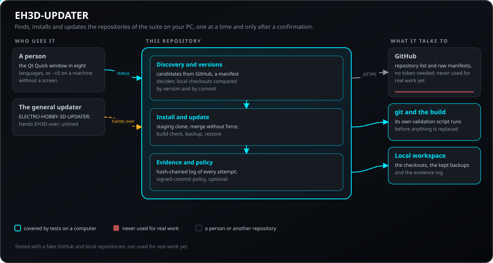
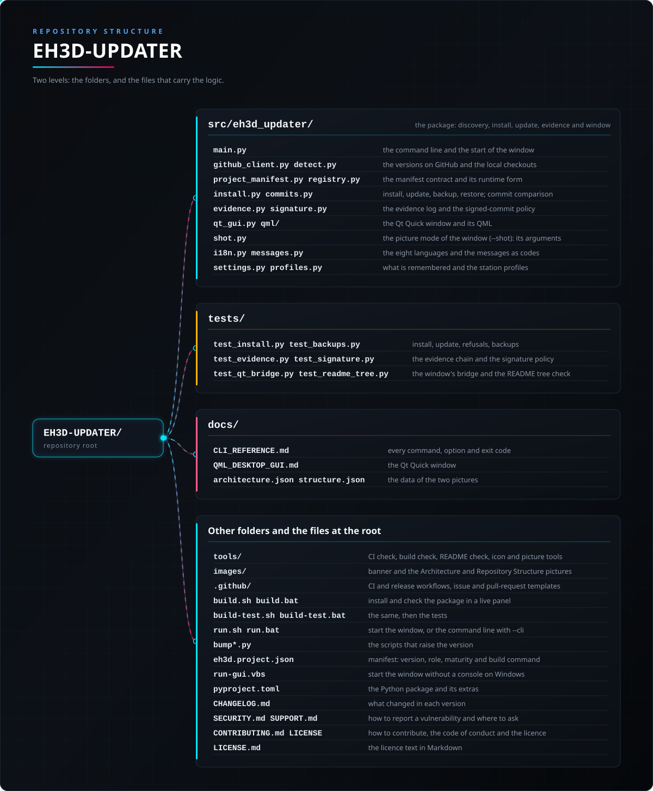

<p align="center">
  
</p>

#  EH3D-UPDATER

<p align="center"><a href="README.md">🇺🇸 English</a> | <a href="README_spa.md">🇪🇸 Español</a> | <a href="README_fra.md">🇫🇷 Français</a> | <a href="README_ita.md">🇮🇹 Italiano</a> | <a href="README_deu.md">🇩🇪 Deutsch</a> | <a href="README_zho.md">🇨🇳 中文</a> | 🇯🇵 <b>日本語</b> | <a href="README_por.md">🇵🇹 Português</a></p>

### EH3D Fabrication Suite のリポジトリを PC 上で検出・インストール・更新します。何も勝手には起きず、使用中のインストールは、置き換えがビルドされ検証されたあとにだけ入れ替えられます

<p align="center">
  
  
  
  
  
</p>

---

**正直さの確認 - 今日実際に動くもの：** EH3D のリポジトリを `eh3d.project.json` マニフェストで見つけ、各ローカル チェックアウトを GitHub と比較し、確認のうえで 1 つずつインストールまたは更新するコマンドラインと Qt Quick ウィンドウです。更新はまずステージング クローンでクローン、強制なしのマージ、ビルド、検証を行い、以前のインストールはバックアップとして残ります。ファミリーの他のエコシステムの更新ツールに EH3D の名前を付けたもので、偽の GitHub とローカル リポジトリを使うテスト 458 件がコンピューター上で動きます。実作業にはまだ使っておらず、実際の GitHub からプロジェクトをインストールまたは更新したこともありません。

---

> **安全性とセキュリティの現状：** 自分のマシン上のファイルを置き換え、インストールするものの検証ビルドを実行するため、明示的な確認のあとにのみ行い、ローカルの変更があるチェックアウトの上には決して行わず、すべての試行を秘密情報を含まない証跡ログに記録します。コミットの署名は、そのポリシーを選んだ場合にだけ検証します。安全装置ではなく、機械は制御しません。

## 📋 ひと目で

| | |
|---|---|
| バージョン | `0.0.8` |
| 成熟度 | 機能する |
| テスト | 458 |
| 技術スタック | Python 3.10+ / PySide6 / Qt Quick |
| 実機での動作 | 該当なし：使う人の PC 上で動きます |

**移動先：** [概要](#-概要) · [アーキテクチャ](#-アーキテクチャ) · [クイックスタート](#-クイックスタート) · [テスト](#-テスト) · [構成](#-リポジトリの構成) · [関連](#-関連プロジェクト)

## 🚦 プロジェクトの状況

各行はこのリポジトリの一部分で、信号は今日どこまで進んでいるかを示します。計画ではなく、リポジトリが示せるもの（テスト、ビルド、実行）に基づいて書かれています。

🟢 完了・検証済み · 🟡 動作する（既知の制限あり） · 🟠 一部のみ、または未検証 · 🔴 未実装または動作しない

| 領域 | 状態 | ここでの意味 |
|---|---|---|
| ソフトウェア | 🟡 | コマンドラインと Qt Quick ウィンドウが、マニフェストで EH3D のリポジトリを見つけ、GitHub と比較し、ステージング クローンと以前のインストールのバックアップを使って 1 つずつインストールまたは更新します。 |
| テスト | 🟡 | 458 件のテストが通ります（`pytest`）。偽の GitHub とローカル リポジトリを使い、ネットワークは使いません。必要な隣接チェックアウトがないと、もう 4 件はスキップされます。 |
| 検出 | 🟡 | 公開リポジトリは候補にすぎません。ルートの `eh3d.project.json` が有効で `EH3D` と書かれているプロジェクトだけがエコシステムに加わります。偽の一覧に対してテスト済みで、実際の GitHub には実行していません。 |
| 実使用 | 🟠 | 実作業にはまだ使っておらず、実際の GitHub からプロジェクトをインストールまたは更新したこともありません。インストールできる EH3D リポジトリはまだ少数です。 |
| インターフェース | 🟡 | ウィンドウは 8 言語で動き、その Python ブリッジはテストで網羅されています。コマンドラインは標準ライブラリだけで動きます。 |
| セキュリティ | 🟡 | 確認なしには、またローカル変更のあるチェックアウトの上では何も変更せず、マージは強制せず、証跡ログは編集・並べ替えられた行を示します。署名付きコミットのポリシーは任意で、独立したレビューは受けていません。 |
| 連携 | 🟡 | ELECTRO-HOBBY-3D-UPDATER が EH3D のプロジェクトをここへ引き渡します。この引き渡しは実際のチェックアウトでは実行していません。 |
| 実機 | 🟡 | 該当なし：使う人の PC 上で動きます。 |
| ドキュメント | 🟡 | 8 言語の README、コマンドライン リファレンス、ウィンドウの手引き。 |

## 🎯 概要

* **マニフェストでプロジェクトを見つける：** GitHub 上の所有者の公開リポジトリは候補の一覧にすぎません。ルートの `eh3d.project.json` が有効でエコシステム `EH3D` を宣言しているものだけがプロジェクトです。新しいリポジトリはマニフェストを持つだけで現れ、このツールの中にプロジェクト一覧はありません。ローカルではフォルダー名だけでエコシステムに加わることはありません。
* **マシンと GitHub を比較する：** 各プロジェクトについて、ローカル チェックアウトのバージョンと GitHub の既定ブランチのバージョンを読み、インストール済み・最新・古い・新しいコミットあり、のいずれかを示します（同じバージョンで新しいコミットがある場合は `git ls-remote` 1 回で気づきます）。
* **確認のうえ、プロジェクトを 1 つずつインストール・更新：** 置き換えはステージング クローンでビルドと検証を行ってから使用中のインストールに触れ、以前のものはバックアップとして残り、ウィンドウまたは `restore-backup` で戻せます。
* **まとめての操作も確認する：** 「不足分をすべてインストール」と「古いものをすべて更新」は、同じ安全な経路を通る別々の順次処理です。バックグラウンドで更新されることはありません。
* **証跡ログと任意の署名付きコミット ポリシー：** すべての試行をログに書き、あとで編集・削除・並べ替えされた行がないか確認できます。
* **ステーション プロファイル：** 名前付きプロファイルがマシンで扱うプロジェクトを列挙し、ウィンドウとコマンドがそれに従います。
* **8 言語のウィンドウと、標準ライブラリだけで動くコマンドライン**（`--cli`）：画面のないマシンでも動きます。
* **先に兄弟リポジトリを：** スキーマ 1.1 のマニフェストは、`Cargo.toml` がパスで参照するリポジトリを `depends_on` に列挙できます。`install` は足りないものを依存順に先にインストールし、存在しない兄弟や循環はエラーとなり、プロジェクト自体を何もクローンしないうちに止まります。
* **開発用 PC 向け、git 経由：** このツールはスイートを開発する人のコンピューターで git を使ってリポジトリをクローン・更新します。作業場の CM5 はこれではなく**リリース経由**で更新されます（EH3D-SERVER の `deploy/eh3d-update.py` が GitHub のリリースを `/opt` にダウンロードします）。

## 🧩 EH3D での役割

EH3D-UPDATER は、スイートを入手して最新に保つための手段です。4 つのエコシステムの上にあるツール ELECTRO-HOBBY-3D-UPDATER は、EH3D のプロジェクトをこれに引き渡します。新しい EH3D リポジトリのためにここですることは何もなく、公開されて有効なマニフェストを持った時点で現れます。

## 🏛️ アーキテクチャ

<p align="center">
  
</p>

このリポジトリの各部分の関係：誰が使い、何を持ち、何に依存するか。図は `docs/architecture.json` から描かれ、コードと照合されます。

## ✨ 機能

* **マニフェストが決める：** 検出、名前、バージョン、ビルド コマンド、注記はすべてリポジトリ自身の `eh3d.project.json` から取られます。マニフェストが無効、またはバージョンがインストール済みより低い候補は、何かに触れる前に拒否されます。
* **健全なチェックアウトは置き換えない：** 実際のローカル編集や分岐したブランチがあると、更新は黙ってリセットされず、はっきり失敗します（`--no-build` では `--ff-only`）。
* **更新前のプレビュー：** `update --preview` は候補コミット、その作者、署名の状態、変更するビルドとツールのファイルを表示して止まります。
* **通知のみ：** `check` は更新できるものを一覧し、何も変更せず、更新できるものがあれば終了コード 10 で終わります（デスクトップ通知は任意）。
* **上限付きのバックアップ：** 以前のインストールは `<名前>.backup-<16 進 8 桁>` として残り、既定では新しい 2 つを保持し、`clean-backups` が残りを整理します。
* **スイート全体のマニフェストを毎週検査します：** CI のジョブ（push のたびと週に一度）が、このツールのパーサーで全リポジトリのマニフェストを読み、拒否されるものや読める版のないものがあれば、それらを列挙して失敗します。あるリポジトリのスキーマ変更に数日で気づけます。
* **ネットワークに優しい：** リクエストは待ち時間を置いて再試行し、短い `Retry-After` は待ち、リポジトリ一覧は `If-None-Match` でキャッシュされ（`304` はクォータを消費しません）、GitHub に届かないときは警告付きでローカルの状態に戻ります。

## 🔒 セキュリティと安全

| 脅威 | 防御 |
|---|---|
| 望まない、または不意の更新 | バックグラウンドでは何も動きません。`install` と `update` はプロジェクト名 1 つと確認を受け取り、ウィンドウの一括ボタンは別々で、順次実行され、確認が必要です |
| 壊れた候補が動いているインストールを置き換える | 候補はステージング クローンでクローン、強制なしのマージ、ビルド、検証を行います。使用中のフォルダーは、そのあとに 2 回のリネームで入れ替えられ、以前のものは復元できるバックアップとして残ります |
| ローカルの作業の消失 | ローカル変更のあるチェックアウトや分岐したブランチは決して置き換えられず、更新ははっきり失敗します |
| スイートの一部を装うリポジトリ | ルートのマニフェストが有効で `EH3D` を宣言しているリポジトリだけが加わります。インストール済みより低いバージョンの候補は拒否されます |
| 出所不明のコミット | 任意のポリシー：`EH3D_UPDATER_REQUIRE_SIGNED=1`（または設定）と許可署名者ファイルがあれば、コミットは署名されていなければなりません。既定では未署名のものも警告付きでインストールされ、`update --preview` は先に署名の状態を示します |
| 起きたことの記録の改ざん | すべてのインストール・更新の試行は、直前の行のハッシュを持つ証跡ログの 1 行です。`evidence` が連鎖を検証し、行が編集・削除・並べ替えられていれば 1 で終了します 制限：チェーンには鍵も外部のアンカーもないため、末尾の行の削除（またはチェーン全体の再計算）は検出されません。 このチェーンは事故を検出するもので、攻撃は検出しません。誤りに備えた記録であり、故意にファイルを編集する人に対する防御ではありません。 |
| 秘密情報の漏えい | 証跡ログに秘密情報は含まれません。GitHub はトークンなしで読み（任意の `GITHUB_TOKEN` はレート制限を引き上げるだけ）、ツールはそれを表示しません |
| ここで実行できない検証スクリプト | 必要なツールがなく検証できないインストールは、受け入れを選ばない限り拒否されます（設定 `validation_unavailable` または `EH3D_UPDATER_ACCEPT_UNAVAILABLE_VALIDATION=1`） |
| 同時に 2 つのインスタンス | ワークスペースで別のインスタンスが作業中だと、バックアップの整理や復元を拒否します |

**防御していないこと：** インストールしたプロジェクトのビルド スクリプトはそのプロジェクト自身のコードで、あなたの権限で実行されます。信頼できるものだけをインストールしてください。未署名のコミットは既定で受け入れられます。ツールは独立したレビューを受けていません。脆弱性は非公開で報告してください（[SECURITY.md](SECURITY.md) 参照）。

## 🔌 インターフェース

| インターフェース | 内容 | 場所 |
|---|---|---|
| ウィンドウ | 8 言語の Qt Quick ウィンドウ（既定。任意の `PySide6` エクストラが必要） | `qt_gui.py`、`qml/Main.qml`、[docs/QML_DESKTOP_GUI.md](docs/QML_DESKTOP_GUI.md) |
| コマンドライン | `eh3d-updater --cli`：`status`、`install`、`update`、`check`、`clean-backups`、`restore-backup`、`evidence`。終了コードは 0、1、10（更新できるものがある） | [docs/CLI_REFERENCE.md](docs/CLI_REFERENCE.md) |
| GitHub | `GET /users/<所有者>/repos`（`If-None-Match` でキャッシュ）と各候補の生マニフェスト。トークン不要 | `github_client.py` |
| ワークスペース | ツールの隣のフォルダー、以前のインストール用の `<名前>.backup-xxxxxxxx`、証跡ログ用の `.eh3d-updater/evidence.jsonl` | `install.py`、`evidence.py` |
| 設定 | `~/.eh3d_updater_settings.json`（言語、ワークスペース、プロファイル、保持するバックアップ、署名ポリシー） | `settings.py` |

## ⚙️ 設定

開始するのに設定は要りません。記憶される選択は `~/.eh3d_updater_settings.json` にあり、一部はオプションや環境変数でも指定できます。

| 設定 | 既定値 | 範囲 | 内容 |
|---|---|---|---|
| `workspace_root` / `--workspace` | ツールの親フォルダー | フォルダー | チェックアウト、バックアップ、証跡ログを置く場所 |
| `lang` | システムの言語 | en、es、de、fr、it、ja、zh、pt | ウィンドウの言語 |
| `profile` / `--profile` | なし（すべてのプロジェクト） | 定義済みのプロファイル名。未定義はエラー | `status`、`check`、`install`、`update` をステーション プロファイルのプロジェクトに限定 |
| `backups_to_keep` / `clean-backups --keep` | 2 | 0 以上の整数 | プロジェクトごとに保持する以前のインストールの数。更新後も少なくとも 1 つは必ず保持されます |
| `require_signed_commits`、`allowed_signers_file` / `EH3D_UPDATER_REQUIRE_SIGNED=1`、`EH3D_UPDATER_ALLOWED_SIGNERS` | オフ | オンまたはオフ | 許可された署名者が署名していないコミットを拒否。認識できない値はオン扱いとなり、警告が出ます |
| `signature_expected_fingerprint` / `EH3D_UPDATER_EXPECTED_FINGERPRINT` | なし（信頼できる任意の鍵） | 鍵のフィンガープリント | 署名付きコミットのポリシーがオンのとき、署名鍵はこのフィンガープリントでなければなりません。有効な署名は git が鍵を信頼している場合（状態 G）にのみ受け入れられます |
| `signature_accept_unknown_trust` | オフ | オンまたはオフ | 信頼が不明な鍵による有効な署名（状態 U）も受け入れます |
| `allow_foreign_origin` | オフ | オンまたはオフ | `origin` がプロジェクトの公式リポジトリではないチェックアウトを更新します（既定では拒否） |
| `validation_unavailable` / `EH3D_UPDATER_ACCEPT_UNAVAILABLE_VALIDATION=1` | 拒否 | 拒否または受け入れ | ツール不足でプロジェクトの検証を実行できないときの動作 |
| `GITHUB_TOKEN` | なし | GitHub トークン | 一覧のレート制限を上げるだけで、必須ではありません |
| `--no-build`（install、update） | オフ | オンまたはオフ | プロジェクト自身のビルド検証なしで、クローンまたは取得のみ（単純な fast-forward） |

ネットワークの値は定数です：1 リクエスト 10 秒、同時に最大 8 リクエスト、待ち時間付きで 3 回試行、`Retry-After` は最大 60 秒。

## 🚀 クイックスタート

Python 3.10 以降が必要です。ウィンドウには PySide6 も必要です（`pip install ".[gui]"`）。

```bash
./run.sh --cli status          # run.bat --cli status on Windows
./run.sh --cli status --offline --json
./run.sh --cli check           # exit code 10 when something can be updated
./run.sh --cli update EH3D-COMMON --preview
./run.sh --cli install EH3D-CORE-LIBS
./run.sh --shot screen.png --size 1500x900   # a picture of the window
```

手動で開かずにウィンドウの画像を撮るには、`--shot FILE.png` を付けて実行します（`--size WxH`, `--wait MS`, `--lang CODE`, `--workspace DIR`, `--replace` も使えます）。指定のサイズで開き、PNG を保存し、設定は保持せず、自動で閉じます（終了コードは、ファイルを書き込めたら 0、書けなければ 1、引数が誤りなら 2）。`--wait MS` はウィンドウが描画するための待ち時間（ミリ秒、既定は 1500）です。ウィンドウは空のワークスペース（または `--workspace` のフォルダー）を表示し、GitHub には問い合わせず、ログも書きません。

`--cli` なしの `run.sh` / `run.bat` はウィンドウを開きます。`install` と `update` は何かに触れる前に確認を求め、常にプロジェクト名を 1 つ取ります。

## 🧪 テスト

テストは 458 件が通ります（`pytest tests`）。必要な隣接チェックアウトがこのフォルダーの隣にないとスキップされるテストがもう 4 件あります。偽の GitHub とローカル リポジトリを使い、ネットワークなしで動き、マニフェストの規約、検出、バージョンとコミットの比較、ステージング クローンを使うインストールと更新、拒否（ローカル変更、分岐したブランチ、低いバージョン、無効なマニフェスト、失敗するビルド）、バックアップと復元、証跡の連鎖、署名ポリシー、設定とプロファイル、メッセージとウィンドウの 8 言語、ウィンドウの Python ブリッジ（オフスクリーン）を網羅します。各 README のファイル ツリーがバージョン管理される第 1 階層の項目をすべて載せているかを調べるテストもあります。CI は Linux と Windows で実行し、さらに `python tools/ci_validate.py` と Python ファイル全体の構文チェックも行います。CI はウィンドウなしでも、パッケージが約束する最も古い Python 3.10 と最も新しい 3.13 で実行し、失敗したコマンドは完全なログファイルの場所を示します。

## 🏗️ ビルドとリリース

バージョンは `pyproject.toml`、`eh3d.project.json`、パッケージにあり、各バージョンには [CHANGELOG.md](CHANGELOG.md) の項目があります。`build.sh` / `build.bat` はパッケージをインストールして検証し、`build-test.sh` / `build-test.bat` はさらにテストも実行し、`test.sh` / `test.bat` はテストだけを実行します。いずれもライブ パネルで動き、バージョンは変えません。リリースは GitHub で公開されます。ツールはこのリポジトリから pip でインストールし、PyPI にはありません。

## 📂 リポジトリの構成

<p align="center">
  
</p>

<details>
<summary>ツリーのテキスト版</summary>

```text
EH3D-UPDATER/
├── src/eh3d_updater/
│   ├── main.py                                  コマンドラインとウィンドウの起動
│   ├── github_client.py detect.py               GitHub のバージョンとローカル チェックアウト
│   ├── project_manifest.py registry.py          マニフェストの規約と実行時の形
│   ├── install.py commits.py                    インストール、更新、バックアップ、コミット比較
│   ├── evidence.py signature.py                 証跡ログと署名ポリシー
│   ├── qt_gui.py qml/                           Qt Quick ウィンドウとその QML
│   ├── shot.py                                  ウィンドウの画像モード（--shot）：その引数
│   ├── i18n.py messages.py                      8 言語とコード化されたメッセージ
│   └── settings.py profiles.py                  記憶する内容とステーション プロファイル
├── tests/                                       ネットワークなし：偽の GitHub とローカル リポジトリ
├── docs/                                        コマンドライン リファレンス、ウィンドウの手引き、2 つの図のデータ
├── tools/                                       CI・ビルド・README のチェック、アイコン、図
├── images/                                      バナーとアーキテクチャ・リポジトリ構成の図
├── .github/                                     CI とリリースのワークフロー、Issue と PR のテンプレート
├── build.sh build.bat                           パッケージをライブ パネルでインストールして検証
├── build-test.sh build-test.bat                 同じことをして、続けてテスト
├── run.sh run.bat                               ウィンドウを起動（--cli でコマンドライン）
├── bump*.py                                     バージョンを上げるスクリプト
├── eh3d.project.json                            マニフェスト：バージョン、役割、成熟度、ビルドコマンド
├── run-gui.vbs                                  Windows でコンソールなしにウィンドウを起動
├── pyproject.toml                               Python パッケージとそのエクストラ
├── CHANGELOG.md                                 各バージョンの変更点
├── SECURITY.md SUPPORT.md                       脆弱性の報告方法と問い合わせ先
├── CONTRIBUTING.md CODE_OF_CONDUCT.md LICENSE   貢献方法、行動規範、ライセンス
└── LICENSE.md                                   Markdown 形式のライセンス文
```

</details>

## 🗺️ ロードマップと既知の制限

**現時点で分かっている制限**

* 実際の GitHub からプロジェクトをインストールまたは更新したことはありません。すべて偽の GitHub とローカル リポジトリでテストしており、インストールできる EH3D リポジトリはまだ少数です。
* ELECTRO-HOBBY-3D-UPDATER からの引き渡しは、実際のチェックアウトでは実行していません。
* コミットの署名は既定では必須ではなく、ポリシーは任意です。
* インストールしたプロジェクトのビルド スクリプトは、あなたの権限で実行されます。
* ツールは独立したレビューを受けておらず、PyPI にもありません。

**次のステップ**

* 実際の GitHub で実際のプロジェクトを最初から最後までインストール・更新し、見つかったことを記録する。
* ELECTRO-HOBBY-3D-UPDATER からの引き渡しを実際のチェックアウトで実行する。
* 署名付きコミットをスイートの既定にするかを決める。

## 🌍 言語

README とテキストは、英語、スペイン語、フランス語、イタリア語、ドイツ語、中国語、日本語、ヨーロッパポルトガル語で提供されています。

## 🔗 関連プロジェクト

* [EH3D-COMMON](https://github.com/JuanenRac/EH3D-COMMON)：プロジェクト コンテナと機械の型。このツールでインストールできます
* [EH3D-CORE-LIBS](https://github.com/JuanenRac/EH3D-CORE-LIBS)：Gerber、Excellon、G コードのリーダー。このツールでインストールできます
* [ELECTRO-HOBBY-3D-UPDATER](https://github.com/JuanenRac/ELECTRO-HOBBY-3D-UPDATER)：4 つのエコシステムの上にある更新ツール。こちらへ引き渡します
* [URTC-UPDATER](https://github.com/JuanenRac/URTC-UPDATER)：URTC の更新ツール。このツールの設計の元です

## 📚 ドキュメント

* [コマンドライン リファレンス](docs/CLI_REFERENCE.md)：すべてのコマンド、オプション、終了コード。
* [デスクトップ ウィンドウ](docs/QML_DESKTOP_GUI.md)：Qt Quick ウィンドウがコマンドラインと同じサービスの上に載る仕組み。
* [変更履歴](CHANGELOG.md)

## 🤝 コントリビュートとコミュニティ

* プルリクエストの前に `PYTHONPATH=src python -m pytest tests -q` と `python -I tools/ci_validate.py` を実行し、すべて通してください。[CONTRIBUTING.md](CONTRIBUTING.md) と[行動規範](CODE_OF_CONDUCT.md)を参照してください。
* README は 8 言語あります。文章を変更するときは 8 つのファイルすべてを変更し、2 つの図は `docs/architecture.json` と `docs/structure.json` から `tools/make_architecture.py` と `tools/make_structure.py` で描画します。
* ユーザーに見える文言の変更は `i18n.py` の 8 言語すべてに入れます。安全に関する判断は Python のサービスで行い、QML では行いません。
* 脆弱性は非公開で報告してください：[SECURITY.md](SECURITY.md)。質問、アイデア、報告：electrohobby3d@gmail.com（[SUPPORT.md](SUPPORT.md)）。

## 👤 作者

**JuanenRac (Electro Hobby 3D)** · electrohobby3d@gmail.com

## 📜 ライセンス

ソフトウェア：GPL-3.0-or-later。[LICENSE](LICENSE) を参照。スイートのハードウェア設計には CERN OHL-S を使います。
